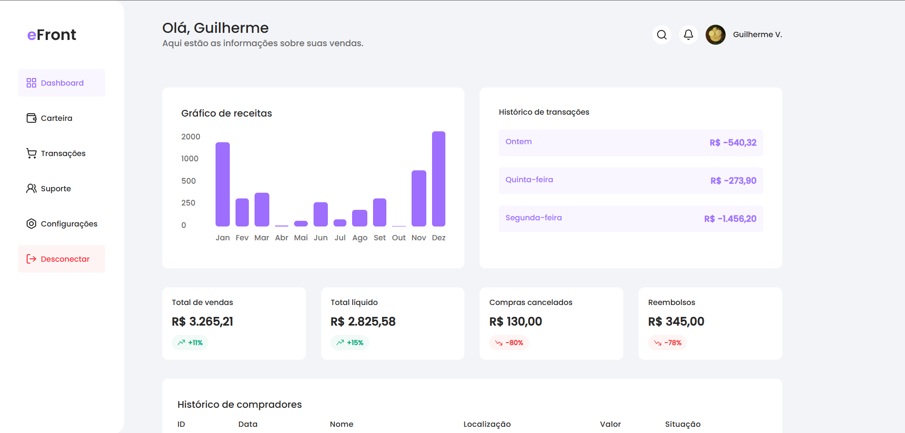

<div align="center">

# sales-dashboard — Dashboard de Vendas com Visualização de Dados

Dashboard de vendas construído com Next.js 15, React 19, Tailwind 4 e SVGR. Layout em App Router com navegação via sidebar, KPIs, gráfico de receitas, histórico de transações e de compradores.

[🔗 Demo ao vivo](https://dashboard-nu-wod.vercel.app/dashboard) · [📦 Repositório](https://github.com/Guilherme-V-Rocha/sales-dashboard)

</div>

---

## 🎯 Sobre

Dashboard de vendas com visualização de dados em tempo real. Construído para exercitar:

- **App Router do Next.js 15** com layout dedicado para a rota `/dashboard`
- **Componentização por feature** — `components/dashboard/` abriga cada bloco visual como subpasta isolada
- **Separação de dados e apresentação** — `src/data/` contém mock data consumida pelos componentes
- **SVGs como componentes React** via SVGR (manipuláveis, estilizáveis, tree-shakeable)
- **Tailwind 4 com Oxide engine** — estilização utility-first, config via `@theme` no CSS
- **Context API** para estado de cabeçalho (`HeaderContext`)
- **Provider centralizado** em `src/util/providers.tsx` para composição limpa no root layout

### Por que este projeto existe

Em 2025–2026, dentro do meu ciclo de estudo focado em Next.js moderno, construí este dashboard como laboratório de:

- **Layouts aninhados no App Router** (root layout + dashboard layout + página)
- **Composição de dados mockados** em uma UI rica (não só uma lista — KPIs, gráficos, tabelas)
- **Estrutura de pastas escalável** — separar `components/`, `data/`, `context/`, `util/`, `icons/`

---

## 🛠️ Stack

| Tecnologia   | Versão  | Uso                                             |
| ------------ | ------- | ----------------------------------------------- |
| Next.js      | 15.3.8  | Framework, App Router, RSC                      |
| React        | ^19.0.0 | UI declarativa                                  |
| TypeScript   | ^5      | Tipagem end-to-end                              |
| Tailwind CSS | ^4      | Estilização utilitária (Oxide engine, `@theme`) |
| SVGR         | ^8.1.0  | SVGs como componentes React                     |
| Lucide React | ^1.21.0 | Ícones                                          |
| ESLint       | ^9      | Lint (flat config + eslint-config-next)         |

---

## 📁 Estrutura

```
sales-dashboard/
├── public/
│   └── images/
│       ├── eFront.svg              # Logo / marca da aplicação
│       └── profile.jpg             # Foto de perfil do usuário mockado
├── src/
│   ├── app/                        # App Router (Next.js 15)
│   │   ├── dashboard/              # Rota /dashboard (rota principal)
│   │   │   ├── page.tsx            # Página /dashboard — monta os 5 blocos
│   │   ├── globals.css             # Estilos globais + tokens Tailwind 4 (@theme)
│   │   ├── layout.tsx              # Root layout (metadata, fontes, Providers)
│   │   └── favicon.ico
│   ├── components/
│   │   ├── dashboard/              # Blocos visuais do dashboard
│   │   │   ├── buyer-history/      # Tabela de compradores
│   │   │   ├── revenue-chart/      # Gráfico de receitas (SVG próprio)
│   │   │   ├── sales/              # KPIs (vendas, líquido, cancelados, reembolsos)
│   │   │   ├── sub-header/         # Sub-cabeçalho (saudação + nome)
│   │   │   └── transaction-history/# Histórico de transações recente
│   │   └── sidebar/                # Navegação lateral (Dashboard, Carteira, etc.)
│   ├── context/
│   │   └── header.context.tsx      # Context para estado do header
│   ├── data/                       # Mock data separada da apresentação
│   │   ├── buyer-history.tsx       # Dados + render da tabela de compradores
│   │   ├── revenue-chart.tsx       # Dados + render do gráfico
│   │   ├── sales.tsx               # Dados + render dos KPIs
│   │   └── transaction-history.tsx # Dados + render das transações
│   ├── icons/                      # SVGs processados via SVGR
│   └── util/
│       ├── providers.tsx           # Composição de providers (Context, fontes, etc.)
│       └── routePaths.ts           # Constantes de rotas tipadas
├── .gitignore
├── README.md                       # Este arquivo
├── eslint.config.mjs               # ESLint 9 flat config
├── next.config.ts                  # Config Next.js (inclui regra SVGR)
├── package.json
├── package-lock.json
├── postcss.config.mjs              # PostCSS + plugin Tailwind 4
└── tsconfig.json
```

### Padrões arquiteturais

- **Feature folders em `components/dashboard/`** — cada bloco (sales, revenue-chart, etc.) é uma subpasta, não um arquivo solto. Facilita adicionar subcomponentes, testes e estilos específicos sem poluir a raiz.
- **Data + render acoplados em `src/data/`** — neste projeto, os arquivos em `data/` exportam tanto os dados mockados quanto o componente que os renderiza. Decisão pragmática para dashboard com dados estáticos; em projeto real, separar.
- **`util/routePaths.ts`** — rotas como constantes tipadas, evitando strings mágicas espalhadas pela codebase.
- **`util/providers.tsx`** — composição centralizada de providers no root layout, mantendo o `layout.tsx` limpo.

---

## 📡 Funcionalidades do dashboard

A rota `/dashboard` renderiza 6 blocos visuais (veja os prints na seção abaixo):

1. **Sidebar** — navegação lateral (Dashboard, Carteira, Transações, Suporte, Configurações, Desconectar)
2. **Sub-header** — saudação personalizada ao usuário
3. **Sales** — 4 KPIs com valor atual e variação percentual (vendas, líquido, canceladas, reembolsos)
4. **Revenue chart** — gráfico de barras SVG com receitas mensais (Jan–Dez)
5. **Transaction history** — lista de transações recentes com dia da semana e valor
6. **Buyer history** — tabela de compradores com ID, data, nome, localização, valor e situação

> Todos os dados são mockados — projeto de estudo, sem backend real.

---

## 📸 Prints

<div align="center">

### Visão geral do dashboard

`public/screenshots/dashboard-full.png`


### Histórico de compradores

`public/screenshots/buyer-history.png`


</div>

> **Como adicionar os prints:**
>
> 1. Crie a pasta `public/screenshots/` no repo (se não existir)
> 2. Salve cada print com o nome correspondente ao placeholder acima
> 3. As imagens já estão referenciadas neste README — ao comitar, vão renderizar automaticamente
> 4. Recomendação: formato `.png`, peso < 500 KB por imagem (use [TinyPNG](https://tinypng.com/) se necessário)

---

## 🚀 Como rodar

### Pré-requisitos

- Node.js 20+

### Instalação

```bash
git clone https://github.com/Guilherme-V-Rocha/sales-dashboard
cd sales-dashboard
npm install
```

## 🎨 Personalização

Para adaptar este dashboard para você:

1. **Dados mockados:** Edite os arquivos em `src/data/` (`sales.tsx`, `revenue-chart.tsx`, `transaction-history.tsx`, `buyer-history.tsx`)
2. **Cores e tokens:** Modifique `src/app/globals.css` (Tailwind 4 usa `@theme` no próprio CSS — não há `tailwind.config.ts`)
3. **Navegação:** Edite `src/components/sidebar/` e `src/util/routePaths.ts` para mudar itens de menu
4. **Perfil:** Substitua `public/images/profile.jpg` e `public/images/eFront.svg`
5. **Header context:** Edite `src/context/header.context.tsx` para mudar estado do header

---

## 🎯 Aprendizados pretendidos

Este projeto foi construído para exercitar:

- **App Router aninhado** — root layout + dashboard layout + página, com escopo de estilos por rota (`dashboard/globals.css`)
- **Feature folders** — organizar componentes por bloco visual, não por tipo
- **SVGR no Next.js 15** — configurar `next.config.ts` para importar SVGs como componentes
- **Tailwind 4 com `@theme`** — definir tokens de design no CSS, sem `tailwind.config.ts`
- **Context API para estado local** — `HeaderContext` para compartilhar estado entre sidebar e header
- **Composição de providers** — `util/providers.tsx` como ponto único de composição

---

## 📄 Licença

Projeto open source para fins de estudo. Sinta-se livre para usar como base, mas personalize o conteúdo para refletir sua própria trajetória de aprendizado.
